<picture>
  <source media="(prefers-color-scheme: dark)" srcset="https://raw.githubusercontent.com/marcusbandit/marcusbandit/main/assets/title-dark.svg">
  
</picture>

  <a href="https://anibeam.app">
    <picture>
      <source media="(prefers-color-scheme: dark)" srcset="https://raw.githubusercontent.com/marcusbandit/marcusbandit/main/assets/anibeam-dark.svg">
      
    </picture>
  </a>

 

  <a href="https://github.com/marcusbandit/banditshell">
    <picture>
      <source media="(prefers-color-scheme: dark)" srcset="https://raw.githubusercontent.com/marcusbandit/marcusbandit/main/assets/desktop-dark.svg">
      
    </picture>
  </a>

